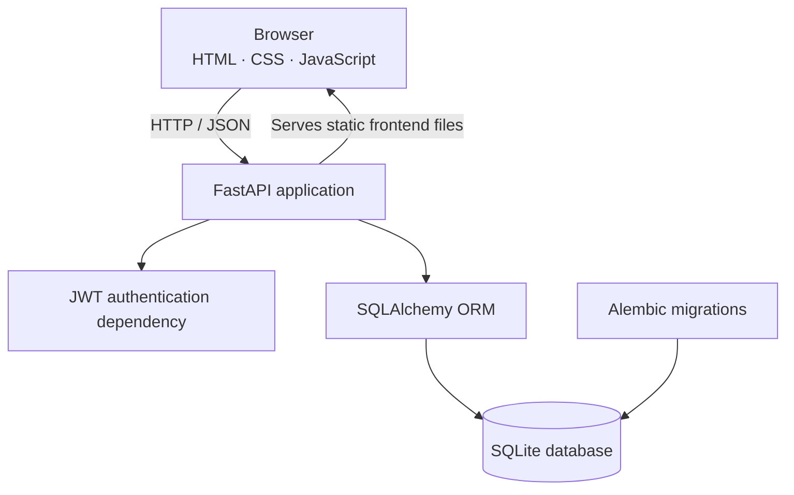

<h1 align="center">Taskly</h1>

<strong>Make space for what matters.</strong>

A full-stack task manager with a focused interface, user-specific tasks, and JWT-based authentication.

  
  
  
  
  

Overview
Taskly is a full-stack task management application built with FastAPI and SQLAlchemy, paired with a responsive frontend written in plain HTML, CSS, and JavaScript. Users can create an account, sign in, and manage their own tasks from a dashboard that keeps task status and progress easy to scan.

The frontend is served by the FastAPI application, so the local development setup can run from a single origin without requiring a separate frontend build step.
Features
- Authentication: account registration, sign-in, password hashing, JWT access tokens, and an access-token refresh endpoint.
- User-scoped tasks: each authenticated user can only list, view, update, or delete tasks associated with their own account.
- Task management: create, edit, complete, search, filter, sort, and delete tasks.
- Progress dashboard: total, active, and completed counts with a visual completion indicator.
- Responsive interface: dashboard, sign-in, and registration pages designed for desktop and smaller screens.
- Small usability details: keyboard shortcut for task search (Ctrl/Cmd + K), inline form feedback, accessible status messages, and confirmation before deletion.
- API documentation: interactive Swagger UI is available at /docs when the backend is running.
- Database migrations: schema changes are organized with Alembic.
- Optional frontend demo mode: the frontend can run with local demo data by changing DEMO_MODE in frontend/js/config.js.
Tech Stack
Layer	Technologies
Backend API	Python, FastAPI, Pydantic
Database access	SQLAlchemy ORM
Database	SQLite by default
Schema migrations	Alembic
Authentication	PyJWT, Passlib/Bcrypt
Configuration	Pydantic Settings and .env
Frontend	HTML, CSS, vanilla JavaScript

Architecture

Project Structure
ToDo_APP/
├── core/
│   ├── auth/
│   │   └── jwt_auth.py
│   ├── core/
│   │   ├── config.py
│   │   └── database.py
│   ├── tasks/
│   │   ├── models.py
│   │   ├── routes.py
│   │   └── schemas.py
│   ├── users/
│   │   ├── models.py
│   │   ├── routes.py
│   │   └── schemas.py
│   ├── alembic/
│   ├── alembic.ini
│   └── main.py
├── frontend/
│   ├── css/
│   ├── js/
│   ├── index.html
│   ├── login.html
│   └── signup.html
├── .env.example
├── .gitignore
├── requirements.txt
├── LICENSE
└── README.md
Getting Started
Prerequisites
- Python 3.12 or newer
- Git
1. Get the project
git clone <your-repository-url>
cd ToDo_APP
Replace <your-repository-url> with the URL of your GitHub repository.
2. Create and activate a virtual environment
Windows PowerShell
py -3.12 -m venv .venv
.\.venv\Scripts\Activate.ps1
macOS / Linux
python3 -m venv .venv
source .venv/bin/activate
3. Install dependencies
python -m pip install --upgrade pip
pip install -r requirements.txt
4. Configure environment variables
Create a local .env file from the example:

Windows PowerShell
Copy-Item .env.example .env
macOS / Linux
cp .env.example .env
Generate a strong, random JWT secret:
python -c "import secrets; print(secrets.token_hex(32))"
Put the generated value in JWT_SECRET_KEY inside .env. Keep .env private and never commit it.

The example configuration uses SQLite at core/sqlite.db. The application is expected to be launched from the repository root so the relative database path stays consistent.
5. Initialize the database
Run the Alembic migrations from the repository root:
python -m alembic -c core/alembic.ini upgrade head
6. Start the application
From the repository root:
python -m uvicorn core.main:app --reload
Open the application at http://127.0.0.1:8000/. The root route redirects to the sign-in page.

Useful URLs:
URL	Purpose
http://127.0.0.1:8000/	Application entry point
http://127.0.0.1:8000/login.html	Sign-in page
http://127.0.0.1:8000/signup.html	Registration page
http://127.0.0.1:8000/docs	Interactive API documentation
http://127.0.0.1:8000/openapi.json	OpenAPI schema

API Reference
Task endpoints require an access token in the Authorization: Bearer <access_token> header.
Method	Endpoint	Description	Authentication
POST	/users/register	Register a user	No
POST	/users/login	Sign in and receive access and refresh tokens	No
POST	/users/refresh-token	Exchange a valid refresh token for a new access token	Refresh token in request body
GET	/tasks	List the current user's tasks	Yes
GET	/tasks/{task_id}	Retrieve one task owned by the current user	Yes
POST	/tasks	Create a task	Yes
PUT	/tasks/{task_id}	Update a task	Yes
DELETE	/tasks/{task_id}	Delete a task; returns 204 No Content	Yes

Example: register
POST /users/register
Content-Type: application/json

{
  "username": "sample_user",
  "password": "use-a-strong-password",
  "password_confirm": "use-a-strong-password"
}
Example: sign in
POST /users/login
Content-Type: application/json

{
  "username": "sample_user",
  "password": "use-a-strong-password"
}
The login response contains access_token and refresh_token. Use the access token to call protected task endpoints. When the access token expires, the frontend attempts to refresh it using /users/refresh-token.
Example: create a task
POST /tasks
Authorization: Bearer <access_token>
Content-Type: application/json

{
  "title": "Plan the week",
  "description": "Choose the most important priorities",
  "is_completed": false
}
Frontend Demo Mode
The frontend is configured to use the FastAPI backend by default. To preview the interface without backend authentication, set DEMO_MODE to true in frontend/js/config.js. In demo mode, task data is stored in the browser's localStorage; demo sign-up does not create a server-side account. Switch DEMO_MODE back to false to use the API.
Security Notes
- Never commit .env, access tokens, refresh tokens, local database files, or virtual environments.
- Use a new randomly generated JWT_SECRET_KEY for each environment. Do not use the example value as a real secret.
- The current frontend stores authentication tokens in localStorage. This is convenient for a learning project, but a production deployment should review its token-storage strategy and browser security controls.
- Password-recovery UI is a placeholder; a password reset flow is not implemented by the current API.
- Before production use, add stricter server-side password policy, generic login errors, refresh-token revocation/rotation, rate limiting, HTTPS, and production-specific configuration.
License
This project is distributed under the MIT License. See LICENSE for details.